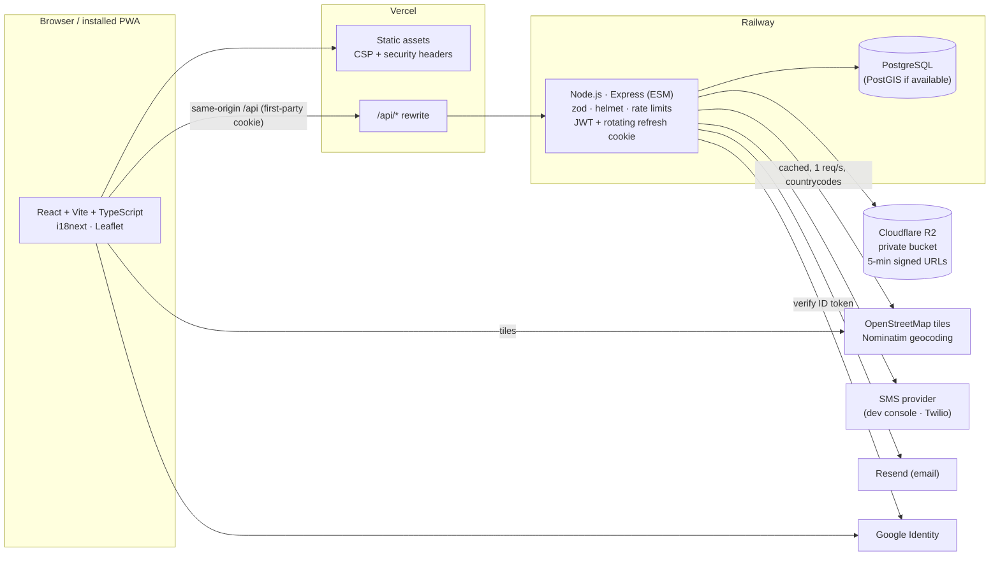

# FoundBack

A trusted, worldwide Lost & Found. People who **find** something post it; people who **lost** something search, claim it and **prove** ownership. Finder and claimer never see each other's contact details, and never meet, until the finder has reviewed the proof and both sides agree.

Each user lives in one **country space**: they only see items, maps, matches, safe places and guidance for their own country. English is the default language everywhere; users can switch to their country's language (or any supported language) at any time.

> **Build status: all 7 stages are built.** Onboarding, found/lost posting with private photo storage, the claim and verification flow, masked chat, handover with a 6-digit code / QR, matching and alerts, notifications (in-app, email, web push), the admin panel with country moderators, post translation and an installable PWA. See [Roadmap](#roadmap).

---

## Contents

- [Architecture](#architecture)
- [Repository layout](#repository-layout)
- [Local setup](#local-setup)
- [Demo accounts](#demo-accounts)
- [Environment variables](#environment-variables)
- [Deploying](#deploying) (Railway, Vercel, Cloudflare R2, Google, SMS)
- [Security model](#security-model)
- [Data model](#data-model)
- [Adding a country](#adding-a-country)
- [Adding a language](#adding-a-language)
- [Testing](#testing)
- [Roadmap](#roadmap)

---

## Architecture



Key decisions:

- **Same-origin API through a Vercel rewrite.** The browser calls `/api/...` on the Vercel domain; Vercel forwards it to Railway. The refresh-token cookie is therefore first-party (`SameSite=Lax`, `httpOnly`, `Secure`), which survives Safari/Chrome third-party-cookie blocking. Direct calls are still supported (`VITE_API_URL` + `COOKIE_SAMESITE=none`).
- **The server is the only authority on country.** `req.countryCode` comes from the signed-in user's database row on every request, never from the request body or query.
- **Migrations run on start** (with an advisory lock, so several replicas can boot safely). The full ISO 3166 country list (252 countries, flags, dialling codes, currencies, time zones, suggested languages) is synced on start without overwriting admin edits.

## Repository layout

```
backend/                     Express API (Railway service root)
  src/
    app.js                   Express app (helmet, CORS allow-list, rate limits, routes)
    index.js                 Entry point: migrate → listen
    config/env.js            zod-validated environment
    db/
      migrations/*.sql       Forward-only SQL migrations (run on start)
      migrate.js             Migration runner (+ country sync)
      countries-sync.js      Inserts missing ISO countries/languages
      seed.js                Demo data for PK, GB, AE, US
    data/                    Country defaults & supported languages
    lib/                     crypto (AES-256-GCM, blind index), phone, geo, errors, audit, validation
    middleware/              auth, rate limits, error handler
    routes/                  auth, me (onboarding/settings/export/delete), meta
    services/                tokens, otp, sms/, email, geocode (Nominatim), countries, users
  test/                      Vitest + Supertest against a real Postgres
  railway.json
frontend/                    React app (Vercel project root)
  src/
    i18n/                    i18next setup + language list
    locales/*.json           One file per language (en, ur, ar complete; others scaffolded)
    auth/AuthProvider.tsx    Session state, silent refresh, language sync
    components/              Header, LanguageSwitcher, PhoneOtpForm, CountryList, HomeAreaMap…
    pages/                   SignIn, Onboarding, Home, Settings, NotFound
    styles/index.css         Design tokens & styles (logical properties for RTL)
  scripts/i18n-tools.mjs     Scaffold missing keys / print translation coverage
  vercel.json                Rewrites, CSP and security headers
.github/workflows/ci.yml     API tests (with Postgres), web tests and build
```

## Local setup

Requirements: Node.js 20+ and PostgreSQL 14+ (PostGIS optional).

```bash
# 1. Database
createdb foundback
createdb foundback_test        # used by the API tests

# 2. API
cd backend
cp .env.example .env           # then fill in the three secrets (see below)
npm install
npm run seed                   # runs migrations + inserts demo data
npm run dev                    # http://localhost:4000

# 3. Web app (new terminal)
cd frontend
cp .env.example .env
npm install
npm run dev                    # http://localhost:5173 (proxies /api to :4000)
```

Generate secrets:

```bash
openssl rand -base64 48   # JWT_ACCESS_SECRET
openssl rand -base64 32   # ENCRYPTION_KEY (must decode to exactly 32 bytes)
openssl rand -base64 48   # HASH_PEPPER
```

With `SMS_PROVIDER=dev` the one-time codes are printed in the API console. With `OTP_DEV_ECHO=true` (development only) the code is also returned to the app and shown on the sign-in screen as "Demo mode: your code is …".

## Demo accounts

`npm run seed` creates onboarded users. Sign in with their number; the one-time code appears in the API log (and on screen when `OTP_DEV_ECHO=true` in development):

| Country | Phone | Name | Language |
|---|---|---|---|
| 🇵🇰 Pakistan | +92 300 1234567 | Ayesha | Urdu |
| 🇵🇰 Pakistan | +92 333 1234567 | Bilal | English |
| 🇵🇰 Pakistan | +92 301 1111111 | FoundBack Admin (role `admin`) | English |
| 🇬🇧 United Kingdom | +44 7412 345678 | Oliver | English |
| 🇬🇧 United Kingdom | +44 7812 345678 | Amelia | English |
| 🇦🇪 UAE | +971 50 123 4567 | Fatima | Arabic |
| 🇦🇪 UAE | +971 55 123 4567 | Rahul | English |
| 🇺🇸 USA | +1 212 555 0147 | Jessica | English |
| 🇺🇸 USA | +1 312 555 0199 | Marcus | English |

It also seeds popular cities, bounding boxes and 13 found items (with encrypted hidden questions) across the four countries, so the home-screen counters show real numbers.

## Environment variables

### API (`backend/.env`, Railway → Variables)

| Variable | Required | Description |
|---|---|---|
| `NODE_ENV` | yes | `production` on Railway |
| `PORT` | no | Railway sets it automatically |
| `DATABASE_URL` | yes | Postgres connection string (Railway reference: `${{Postgres.DATABASE_URL}}`) |
| `DATABASE_SSL` | no | `true` if your Postgres requires TLS (public URL) |
| `CORS_ORIGINS` | yes | Comma-separated allowed origins, `*` wildcard allowed, e.g. `https://foundback.vercel.app,https://*.vercel.app` |
| `APP_URL` | yes | Public web URL (used in emails) |
| `TRUST_PROXY` | no | Proxy hops in front of the API. `2` when traffic comes through the Vercel rewrite + Railway edge, `1` for direct |
| `JWT_ACCESS_SECRET` | yes | ≥ 32 chars, signs 15-minute access tokens |
| `ACCESS_TOKEN_TTL` | no | Default `15m` |
| `REFRESH_TOKEN_TTL_DAYS` | no | Default `30` |
| `COOKIE_SAMESITE` | no | `lax` (default, with rewrite) or `none` (direct cross-site calls) |
| `ENCRYPTION_KEY` | yes | 32 bytes, base64. AES-256-GCM key for phone numbers, ID numbers, IMEI, hidden answers. **Back it up — data is unreadable without it.** |
| `HASH_PEPPER` | yes | ≥ 32 chars. HMAC key for blind indexes, OTP and handover codes |
| `GOOGLE_CLIENT_ID` | no | Enables Google sign-in |
| `SMS_PROVIDER` | no | `dev` (log codes) or `twilio` |
| `OTP_DEV_ECHO` | no | `true` returns codes to the app; ignored when `NODE_ENV=production` |
| `TWILIO_ACCOUNT_SID`, `TWILIO_AUTH_TOKEN`, `TWILIO_FROM` | with Twilio | Twilio credentials and sender |
| `RESEND_API_KEY` | no | Emails are logged instead of sent when empty |
| `EMAIL_FROM` | no | Verified Resend sender, e.g. `FoundBack <no-reply@yourdomain.com>` |
| `NOMINATIM_URL` | no | Default public Nominatim; use your own instance for heavy traffic |
| `NOMINATIM_EMAIL` | yes (prod) | Contact email sent in the User-Agent (OSM usage policy) |
| `LOG_LEVEL` | no | `info` by default |
| `R2_ACCOUNT_ID`, `R2_ACCESS_KEY_ID`, `R2_SECRET_ACCESS_KEY`, `R2_BUCKET` | yes (prod) | Cloudflare R2 credentials (see below). Without them, photos are stored in Postgres — development only |
| `SIGNED_URL_TTL_SECONDS` | no | Lifetime of image URLs, default `300` (5 minutes) |
| `API_PUBLIC_URL` | no | Only for locally stored files; leave empty with the `/api` rewrite |
| `FACE_BLUR_PROVIDER` | no | `none` (default) or `rekognition` — blurs faces in public photos |
| `IMAGE_MODERATION_PROVIDER` | no | `none` (default) or `rekognition` — rejects unsafe images |
| `AWS_REGION`, `AWS_ACCESS_KEY_ID`, `AWS_SECRET_ACCESS_KEY` | with Rekognition | AWS credentials with `rekognition:DetectFaces` and `rekognition:DetectModerationLabels` |
| `TRANSLATE_PROVIDER` | no | `none` (default), `google`, `deepl` or `openai` (any OpenAI-compatible API) |
| `GOOGLE_TRANSLATE_API_KEY` / `DEEPL_API_KEY` (+ `DEEPL_API_URL`) / `OPENAI_API_KEY` (+ `OPENAI_BASE_URL`, `OPENAI_MODEL`) | with that provider | Translation provider credentials |
| `VAPID_PUBLIC_KEY`, `VAPID_PRIVATE_KEY`, `VAPID_SUBJECT` | for push | Web push keys: `npx web-push generate-vapid-keys`; subject `mailto:you@yourdomain.com` |
| `OVERPASS_URL` | no | OpenStreetMap Overpass endpoint for safe handover places |
| `JOBS_ENABLED` | no | `true` (default). Background jobs: claim expiry (7 days), 90-day reminders, handover reminders. Set `false` on extra replicas |

### Web app (`frontend/.env`, Vercel → Environment Variables)

| Variable | Description |
|---|---|
| `VITE_API_URL` | Leave empty to use the `/api` rewrite (recommended). Set to the Railway URL only for direct calls. |
| `VITE_GOOGLE_CLIENT_ID` | Same client ID as the API. Google sign-in is hidden when empty. |

## Deploying

### 1. Railway — Postgres + API

1. Create a Railway project → **New → Database → PostgreSQL**. If you want PostGIS, deploy Railway's **PostGIS** template instead; the app detects it automatically (migration `002`) and works without it.
2. **New → GitHub Repo** → pick this repository. In the service **Settings**, set **Root Directory** to `backend`. Railway picks up `backend/railway.json` (build, start command, `/api/health` health check).
3. In **Variables**, add everything from the API table above. Use `DATABASE_URL=${{Postgres.DATABASE_URL}}`, `NODE_ENV=production`, `TRUST_PROXY=2`.
4. **Settings → Networking → Generate Domain**. Note the URL, e.g. `https://foundback-api.up.railway.app`. Visit `/api/health` → `{"ok":true}`.
5. Seed demo data once (optional): Railway service → **⋯ → Run command** `npm run seed`, or locally with `DATABASE_URL` pointing at the Railway database.

Migrations run on every start, so new deploys update the schema automatically.

### 2. Vercel — web app

1. **Add New → Project** → import this repository. Set **Root Directory** to `frontend`. Framework preset: Vite (detected).
2. Edit `frontend/vercel.json`: replace `https://YOUR-API.up.railway.app` in the `/api` rewrite with your Railway domain and commit.
3. Add `VITE_GOOGLE_CLIENT_ID` if you use Google sign-in. Leave `VITE_API_URL` empty.
4. Deploy. Add the Vercel domain (and `https://*.vercel.app` for previews) to the API's `CORS_ORIGINS`.

`vercel.json` also sets a strict Content-Security-Policy (self-hosted fonts, OSM tiles, Google Identity, R2 images), HSTS, `X-Frame-Options: DENY`, `nosniff`, a referrer policy and a permissions policy (geolocation and camera only for the app itself).

### 3. Cloudflare R2 — images

1. Cloudflare dashboard → **R2 → Create bucket**, e.g. `foundback-images`. Keep **public access disabled**: the API serves images only through 5-minute signed URLs.
2. **R2 → Manage R2 API Tokens → Create API token** with *Object Read & Write* on that bucket only. Copy the Access Key ID, Secret Access Key and your Account ID into `R2_ACCESS_KEY_ID`, `R2_SECRET_ACCESS_KEY`, `R2_ACCOUNT_ID`, `R2_BUCKET`.
3. Bucket → **Settings → CORS policy**:

   ```json
   [
     {
       "AllowedOrigins": ["https://foundback.vercel.app"],
       "AllowedMethods": ["GET", "PUT"],
       "AllowedHeaders": ["content-type"],
       "MaxAgeSeconds": 300
     }
   ]
   ```

Object keys are `{country}/{yyyy-mm}/{uuid}.jpg` with `{uuid}_thumb.jpg` thumbnails alongside. Every upload is re-encoded (EXIF/GPS removed), resized to max 1600 px, and — for categories whose photos are public — faces are blurred when `FACE_BLUR_PROVIDER=rekognition`.

### 6. Web push, translation and image services (optional)

- **Push:** run `npx web-push generate-vapid-keys` once and set `VAPID_PUBLIC_KEY`, `VAPID_PRIVATE_KEY`, `VAPID_SUBJECT`. Users turn push on in **Settings → Notifications**.
- **Translation:** set `TRANSLATE_PROVIDER` and its key. The "Translate to <my language>" buttons appear automatically; results are cached in `translations_cache`. Hidden answers are never sent to the provider.
- **Face blur / moderation:** set `FACE_BLUR_PROVIDER=rekognition` and/or `IMAGE_MODERATION_PROVIDER=rekognition` with AWS credentials. Images the provider can't decide go to **Admin → Photos**.

### 4. Google sign-in

Google Cloud Console → **APIs & Services → Credentials → Create OAuth client ID → Web application**. Add your Vercel domain (and `http://localhost:5173`) to **Authorized JavaScript origins**. Use the client ID for both `GOOGLE_CLIENT_ID` and `VITE_GOOGLE_CLIENT_ID`.

### 5. SMS

`SMS_PROVIDER=dev` logs codes (fine for demos; in production read them from Railway logs). For real SMS set `SMS_PROVIDER=twilio` and the Twilio variables. To add another provider, implement `send({ to, body })` in `backend/src/services/sms/index.js` and register it.

## Security model

- **Authentication.** Phone OTP (6 digits, HMAC-hashed, 5-minute expiry, 5 attempts, 3 codes per 10 minutes per number) or Google ID token. Access tokens are 15-minute JWTs kept in memory only. Refresh tokens are opaque, stored hashed, sent as an `httpOnly` cookie scoped to `/api/auth`, **rotated on every use**; re-using an old one revokes the whole session family (theft detection), with a 10-second grace window for two tabs refreshing at once.
- **Field encryption.** AES-256-GCM (`v1:iv:tag:ciphertext`, versioned for key rotation) for phone numbers, ID numbers, IMEI/serials and hidden answers. Lookups and comparisons use keyed HMAC "blind indexes", never plaintext. Phones are only ever shown masked (`+92 •••• 4567`).
- **Country scoping.** Enforced on the server from the user row. Cities, home pins (reverse-geocoded) and phone numbers must belong to the user's country. Nominatim city results are returned with an HMAC-signed reference, so the client cannot invent a city or move it to another country.
- **Input validation.** zod on every body, query and parameter; consistent errors: `{ "error": { "code", "message", "details"? } }`. The web app translates `code` into the user's language.
- **Hardening.** helmet, CORS allow-list, rate limits (global, auth, OTP, geocoding), JSON body limit, no stack traces in responses, PII-redacting logs, audit log of sensitive actions (sign-ups, phone verification, country changes, exports, deletions, refresh-token re-use).
- **Privacy.** Data export (`GET /api/me/export`) and account deletion (anonymises the profile, closes open posts and claims, revokes sessions). Exact item locations are stored privately; the public point is randomised within a 500 m circle that always contains the real point.

## Data model

All tables are created in `backend/src/db/migrations/001_init.sql`; stage 1 uses the user, auth and country tables, and the rest are ready for later stages.

| Table | Purpose |
|---|---|
| `countries` | Admin-editable per-country config: name, flag, dialling codes, currency, distance unit, time zones, emergency number, authority name, national ID name, ID-number pattern (used to block IDs in public text), guidance per language (`{ en: {ids, documents, cash, general}, ur: {…} }`), safe-place types, enabled flag, optional bounding box |
| `country_languages` | Languages offered next to English, in order |
| `cities` | Seeded popular cities + places picked from Nominatim (`source`, `external_id`) |
| `users` | Profile, `country_code`, `city_id`, optional home area, `language`, `timezone`, `currency`, `units`, `locale`, `text_dir`, role, trust score, encrypted phone + blind index, country-change timestamp, travel mode |
| `refresh_tokens` | Hashed rotating refresh tokens grouped in families |
| `otp_codes` | Hashed one-time codes, attempts, expiry |
| `identity_checks` | Optional ID number (encrypted) + selfie, admin review |
| `found_items` | Exact location (private) and approximate public circle, category, status, where the item is now |
| `lost_reports` | Area + time range, encrypted private details, reward, `is_travel`, `travel_until` |
| `item_photos` | R2 keys, thumbnail key, `is_public` (false for IDs/cards/documents), moderation status |
| `hidden_questions` | Finder's questions + encrypted answers |
| `claims`, `claim_answers`, `claim_proofs` | Claims (one approved per item enforced by a partial unique index), encrypted answers and proofs |
| `matches`, `saved_alerts` | Lost ↔ found matches with score breakdown; alert subscriptions |
| `conversations`, `messages` | Masked chat (one conversation per claim), original language |
| `translations_cache` | Cached translations by source hash + target language |
| `handovers` | Mutual agreement, method, place, phone-reveal opt-ins, HMAC of the handover code, completion |
| `ratings`, `reports` | Post-return ratings/stories; abuse reports |
| `notifications`, `push_subscriptions` | In-app/email/push notifications rendered in the user's language |
| `moderators` | Moderator → countries |
| `audit_log` | Sensitive actions (no secrets) |
| `geocode_cache` | Shared Nominatim cache |

Every user-generated table carries `country_code` and is indexed on it (plus `(country_code, lat, lng)` for geo tables; GiST geography indexes when PostGIS is present).

## Adding a country

All 252 ISO 3166 countries already exist with sensible defaults (flag, dialling code, currency, time zone, km/miles, suggested languages, emergency number `112` unless known). To give a country richer configuration:

1. **Now (code):** add an entry to `COUNTRY_OVERRIDES` (and `EMERGENCY`, `LANGUAGE_OVERRIDES` if needed) in `backend/src/data/countries.js`. These defaults are applied only when a country is first inserted, so for an existing database also update the row:

   ```sql
   UPDATE countries SET national_id_name = 'NIC', emergency_number = '119',
     guidance = '{"en": {"ids": "…", "documents": "…", "cash": "…", "general": "…"}}'
   WHERE code = 'LK';
   INSERT INTO country_languages (country_code, language, position) VALUES ('LK', 'ta', 1);
   ```

2. **From stage 6:** edit everything from the admin panel (per-country configuration screen), including enabling/disabling a country.
3. Optionally seed popular cities (`backend/src/db/seed.js` → `CITIES`) for instant results; otherwise city search uses Nominatim limited to that country.

## Adding a language

1. Add the language to **both** `backend/src/data/languages.js` and `frontend/src/i18n/languages.ts` (`code`, `name`, `native`, `dir`). A backend test fails if the two lists differ.
2. Run `npm run i18n:scaffold` in `frontend/`. It creates `src/locales/<code>.json` with every English key (empty values) and adds new keys to existing files without touching translations.
3. Translate the strings. Empty strings fall back to English automatically. Use i18next plural suffixes for the language's plural rules (`_zero`, `_one`, `_two`, `_few`, `_many`, `_other`).
4. Check progress with `npm run i18n:coverage`.
5. For a right-to-left language set `dir: 'rtl'`; the layout mirrors automatically (`<html dir>` + CSS logical properties). If it needs a special font, add it in `src/main.tsx` and `styles/index.css` (see the Urdu/Arabic rules).
6. Optional: add OTP SMS text in `backend/src/services/sms/index.js` and country guidance in that language.

## Testing

```bash
cd backend && npm test     # needs Postgres; uses TEST_DATABASE_URL or postgresql://postgres@localhost:5432/foundback_test
cd frontend && npm test
```

The API suite (54 tests) runs against a real database that it resets and seeds. It covers OTP sign-in, attempt limits and throttling, refresh-token rotation and re-use detection, logout, encryption and blind indexes, phone-country validation, onboarding rules (city/home pin/phone must be in the user's country, signed city references cannot be forged), country scoping of counters and city search, the 30-day country-change cooldown, data export, account deletion and the error format.

The web suite checks English as the default, instant switching to Urdu/Arabic with RTL, Arabic plural rules, fallback to English for missing keys and unsupported languages, and that Urdu and Arabic contain every English string.

It also covers posting (EXIF stripping, approximate locations, blocked contact details, pins outside the country, private ID photos), country scoping (another country's items return 404 for viewing, questions and claims), travel mode, the full claim → follow-up → approval → handover-code → returned → rating flow, ID-number comparison without disclosure, claim limits and proof rules, masked chat, matching across/within countries, saved alerts, moderator country scoping, admin country configuration, bans, identity checks and the claim-expiry job.

## Roadmap

| Stage | Scope | Status |
|---|---|---|
| 1 | Schema, auth, onboarding (country/city/phone/language), i18n + RTL | ✅ Done |
| 2 | Found & lost posting, R2 uploads (EXIF strip, face blur, thumbnails), browse/map, server-side scoping | ✅ Done |
| 3 | Claim & verification flow | ✅ Done |
| 4 | Masked chat, handover with code/QR | ✅ Done |
| 5 | Matching, saved alerts, notifications (in-app, email, push) | ✅ Done |
| 6 | Admin panel, moderators, per-country configuration, translation coverage | ✅ Done |
| 7 | Post translation, design polish, PWA, final testing | ✅ Done |

### Product decisions taken (change them if you prefer otherwise)

- **Phone numbers must belong to the user's country**, and changing country asks for a phone number from the new country. An expat using a home-country SIM cannot verify. Relax this in `backend/src/lib/phone.js` (`normalizePhone`) and `routes/me.js` if needed.
- **Travel mode** also lets the traveller open and claim items in that one other country (otherwise a match abroad could never be claimed).
- **Chat** stays masked even after approval; phone numbers are only revealed on the handover screen when both people opt in.
- **Rewards** are recorded for the owner's records only; FoundBack never handles money.
- **Sign-in screen** defaults the dialling code to the visitor's detected country, or Pakistan if none is detected.
- Chat uses polling every 4 seconds (no WebSockets), which keeps Railway hosting simple.

---

FoundBack connects people. Meet only in safe public places.
